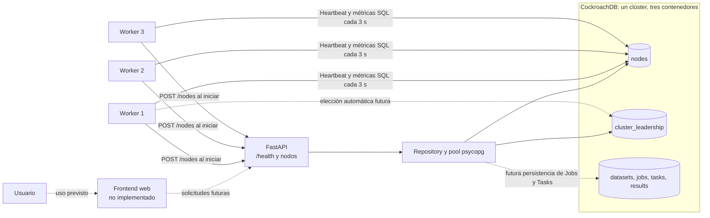

# Distributed ML

Distributed ML es un proyecto académico para explorar cómo se relacionan
un servicio web, varios procesos Worker y una base de datos distribuida
en un sistema de entrenamiento de Machine Learning.

El objetivo arquitectónico es repartir el procesamiento de un dataset
entre Workers y persistir su estado en CockroachDB. El código actual
incluye el servicio FastAPI básico, el registro de Workers, la publicación
directa de Heartbeat y métricas en CockroachDB y primitivas persistentes
de liderazgo. La interfaz web, el Scheduler y el entrenamiento
distribuido todavía no están implementados.

## Características y estado

| Capacidad | Estado |
|---|---|
| Clúster local CockroachDB de tres nodos | Verificado: un solo clúster, `num_replicas = 3` y cada rango con réplicas en los tres nodos. La app sigue funcionando si cae cualquier nodo y responde con errores claros si se pierde el quórum. |
| Registro inicial de Workers | Implementado con `POST /nodes`. |
| Heartbeat y métricas de Workers | Implementados: cada Worker publica directamente en CockroachDB cada 3 segundos por defecto. |
| Lease persistente de liderazgo | Tabla y operaciones de repositorio implementadas; no hay elección automática. |
| Carga de datasets CSV | Implementada: `POST /datasets` recibe el archivo, lo valida, lo guarda en `backend/storage/datasets/` y registra sus metadatos. |
| Preparación de datos | Implementada: `POST /jobs` valida el target, codifica, normaliza y separa train/test estratificado antes de crear el Job. |
| Frontend | No implementado. |
| Scheduler, ejecución ML distribuida y recuperación de Tasks | Objetivos arquitectónicos; todavía no son flujos operativos. |

El diseño técnico de elección de coordinador, fencing, comunicación
entre Workers y recuperación está descrito en
[docs/distributed-coordination-architecture.md](docs/distributed-coordination-architecture.md).
Este README resume el sistema completo sin asumir que esas etapas futuras
ya funcionen.

## Arquitectura

La arquitectura distingue el clúster de datos del clúster de cómputo.
Los tres contenedores CockroachDB constituyen una única base lógica; los
Workers son procesos Python independientes. En la implementación
actual, FastAPI recibe el registro inicial y los Workers se conectan por
su cuenta a CockroachDB para las publicaciones periódicas.



### Componentes

- **FastAPI:** inicializa su pool de CockroachDB y ofrece `GET /health`,
  `POST /nodes` y `POST /nodes/{node_id}/heartbeat`. El endpoint HTTP de
  Heartbeat se conserva, pero el Worker actual no lo utiliza después
  del registro.
- **Workers:** cada proceso se registra una vez por HTTP, conserva el
  `node_id` recibido y mantiene su propio pool de CockroachDB. Publica el
  estado, el Heartbeat y las métricas cada 3 segundos por defecto. No
  ejecuta entrenamiento ni participa en una elección de liderazgo.
- **Repository y conexión:** proporcionan operaciones de persistencia
  usando el pool síncrono de Psycopg. El repositorio incluye operaciones
  para el lease, pero estas no son invocadas automáticamente por los
  Workers.
- **CockroachDB:** conserva nodos, metadatos de aplicación y la fila de
  liderazgo. Docker Compose define tres contenedores en el mismo host;
  tres contenedores no demuestran por sí solos replicación de datos ni
  tolerancia a la pérdida de un host.
- **Coordinador:** en el diseño objetivo, un Worker con el lease vigente
  coordinará Jobs y Tasks. La elección, el Scheduler y la comunicación
  Worker-a-Worker aún no están implementados.
- **Frontend:** el directorio `frontend/` está vacío; no hay interfaz
  ejecutable actualmente.

## Flujo de funcionamiento

### Registro y publicación de Workers

1. Se inicia FastAPI y cada Worker envía hostname, IP si está disponible,
   núcleos lógicos y RAM total a `POST /nodes`.
2. FastAPI crea un registro `offline` en `nodes` y devuelve el UUID.
3. El Worker conserva ese `node_id` y abre un pool propio usando
   `DATABASE_URL`.
4. Cada 3 segundos, el Worker actualiza solo su fila: la marca como
   `online`, fija `last_heartbeat` y `metrics_updated_at` con el reloj de
   CockroachDB, y publica CPU disponible, RAM disponible y tareas activas.
5. Si CockroachDB se interrumpe temporalmente, el proceso sigue vivo e
   intenta publicar de nuevo con el pool existente. FastAPI es necesario
   para el registro inicial, pero no para las publicaciones posteriores.

La CPU disponible se estima con contadores del sistema operativo; en
Linux se limita a la cuota cgroup cuando está disponible. La RAM
disponible se obtiene del sistema operativo y se limita a memoria cgroup
en Linux cuando aplica. Si una medición no puede obtenerse de forma
fiable, se guarda `NULL`. `active_tasks` es `0` porque no existe un
ejecutor de Tasks. Estas métricas son observaciones del sistema, no
garantías de elegibilidad para coordinar.

### Flujo de entrenamiento previsto

El flujo integral esperado es el siguiente. Los pasos de carga,
planificación, ejecución y resultados son objetivos de arquitectura; no
están expuestos por los módulos actuales.

1. El usuario carga un CSV con `POST /datasets`. La API lo valida, lo
   guarda en el disco local del Backend y registra sus metadatos en
   `datasets` (implementado).
2. El usuario crea un Job con `POST /jobs`. La API prepara el dataset
   (valida el target, codifica, normaliza y separa train/test) y, si
   todo es válido, registra parámetros, algoritmo, columna objetivo y
   cantidad de Workers en `jobs` (implementado).
3. El coordinador preparará particiones y creará Tasks en `tasks`.
4. La membresía y las métricas disponibles estarán en `nodes`. Un
   Scheduler futuro elegirá Workers; actualmente no existe esa selección.
5. Las operaciones de lease permiten adquirir y validar liderazgo desde
   el repositorio. La elección automática de un Worker coordinador aún
   no existe.
6. El coordinador distribuirá Tasks a los Workers y controlará intentos,
   leases y época del coordinador.
7. Los Workers procesarán sus particiones; el proceso actual solo
   registra y publica Heartbeat/métricas.
8. El coordinador recibirá y agregará los resultados de las particiones.
9. El resultado final se almacenará en `results`.
10. Una futura interfaz consultará el estado del Job y sus métricas.

## Tecnologías

| Tecnología | Responsabilidad |
|---|---|
| Python 3.10 o posterior | API, repositorio y procesos Worker. |
| FastAPI y Uvicorn | API HTTP actual y servidor local. |
| Psycopg 3 y `psycopg_pool` | Acceso SQL síncrono y pools de conexión a CockroachDB. |
| CockroachDB | Persistencia SQL distribuida del proyecto. |
| Docker Compose | Ejecución local de los tres contenedores CockroachDB. |
| Biblioteca estándar de Python | Cliente HTTP del Worker y obtención de métricas del sistema. |
| `unittest` | Pruebas de integración del repositorio de liderazgo. |

`backend/requirements.txt` declara FastAPI, Uvicorn, Psycopg y
`python-multipart` (necesario para recibir archivos). PyTorch
forma parte del diseño previsto para el entrenamiento, pero no está
incluido en las dependencias actuales ni se ejecuta en este repositorio.
El frontend previsto utilizará HTML, CSS y JavaScript sin framework,
pero todavía no contiene archivos.

## Estructura del proyecto

```text
.
├── backend/
│   ├── main.py
│   ├── dataset_storage.py      # Guarda, valida y borra los CSV subidos
│   ├── requirements.txt
│   ├── api/
│   │   ├── nodes.py
│   │   ├── datasets.py
│   │   ├── jobs.py
│   │   ├── cluster.py
│   │   └── training.py
│   ├── coordinator/
│   │   ├── scheduler.py
│   │   ├── preprocessing.py   # Target, codificación, normalización y split
│   │   ├── partitioner.py
│   │   └── aggregator.py
│   ├── database/
│   │   ├── connection.py
│   │   ├── repository.py
│   │   ├── schema.sql
│   │   └── migrations/
│   │       └── 001_create_cluster_leadership.sql
│   ├── storage/
│   │   └── datasets/
│   ├── tests/
│   │   ├── test_leadership_repository.py
│   │   └── test_preprocessing.py
│   └── workers/
│       ├── worker.py
│       └── training_engine.py
├── docs/
│   └── distributed-coordination-architecture.md
├── frontend/                 # Directorio vacío; UI no implementada
└── docker-compose.yml
```

`backend/api/nodes.py` implementa el registro y el endpoint HTTP de
Heartbeat. `backend/api/datasets.py` implementa la carga y gestión de
CSV, apoyado en `backend/dataset_storage.py` para el manejo de archivos.
`backend/coordinator/preprocessing.py` prepara los datos para el
entrenamiento y `backend/api/jobs.py` lo usa al crear un Job. Los módulos de `cluster` y `training`, `coordinator/partitioner.py`,
`coordinator/aggregator.py` y `workers/training_engine.py` son
marcadores sin funcionalidad. `backend/database/schema.sql` es un placeholder;
el esquema integral de referencia está en este README. La migración de
liderazgo sirve para aplicar esa tabla de forma aditiva a una base ya
existente; no sustituye el DDL de instalación limpia de abajo.

## Modelo de datos

El siguiente DDL es **un único esquema lógico integral de referencia
para una instalación nueva**. Incluye las columnas de coordinación e
intentos previstas aunque la lógica que las utilizará todavía no esté
implementada. No es una migración ni debe ejecutarse indiscriminadamente
sobre una base existente: crea las tablas desde cero y fallará si ya
existen. La inserción inicial del liderazgo usa `ON CONFLICT DO NOTHING`
para no reiniciar una fila existente.

En una instalación nueva, crear primero la base `distributed_ml` y
ejecutar este bloque dentro de esa base:

```sql
CREATE TABLE nodes (
    node_id UUID PRIMARY KEY DEFAULT gen_random_uuid(),
    hostname STRING NOT NULL,
    ip_address STRING,
    status STRING NOT NULL DEFAULT 'offline',
    cpu_cores INT4,
    ram_mb INT4,
    last_heartbeat TIMESTAMPTZ,
    cpu_available_cores FLOAT8,
    ram_available_mb INT4,
    active_tasks INT4,
    metrics_updated_at TIMESTAMPTZ,
    coordination_url STRING,
    created_at TIMESTAMPTZ NOT NULL DEFAULT now(),
    updated_at TIMESTAMPTZ NOT NULL DEFAULT now(),
    CONSTRAINT chk_node_status
        CHECK (status IN ('online', 'offline', 'busy'))
);

CREATE TABLE datasets (
    dataset_id UUID PRIMARY KEY DEFAULT gen_random_uuid(),
    name STRING NOT NULL,
    file_path STRING NOT NULL,
    file_size_bytes INT8,
    row_count INT8,
    column_count INT4,
    file_format STRING NOT NULL DEFAULT 'csv',
    created_at TIMESTAMPTZ NOT NULL DEFAULT now()
);

CREATE TABLE jobs (
    job_id UUID PRIMARY KEY DEFAULT gen_random_uuid(),
    dataset_id UUID NOT NULL REFERENCES datasets(dataset_id),
    algorithm STRING NOT NULL,
    target_column STRING NOT NULL,
    status STRING NOT NULL DEFAULT 'pending',
    parameters JSONB NOT NULL DEFAULT '{}'::JSONB,
    requested_workers INT4 NOT NULL,
    actual_workers INT4,
    train_ratio FLOAT8,
    seed INT8,
    error_message STRING,
    created_at TIMESTAMPTZ NOT NULL DEFAULT now(),
    started_at TIMESTAMPTZ,
    completed_at TIMESTAMPTZ,
    CONSTRAINT chk_job_status
        CHECK (status IN (
            'pending', 'running', 'completed', 'failed', 'cancelled'
        )),
    CONSTRAINT chk_requested_workers CHECK (requested_workers > 0),
    CONSTRAINT chk_train_ratio
        CHECK (train_ratio IS NULL OR (train_ratio > 0 AND train_ratio < 1))
);

CREATE TABLE tasks (
    task_id UUID PRIMARY KEY DEFAULT gen_random_uuid(),
    job_id UUID NOT NULL REFERENCES jobs(job_id) ON DELETE CASCADE,
    node_id UUID REFERENCES nodes(node_id) ON DELETE SET NULL,
    partition_index INT4 NOT NULL,
    rows_assigned INT8,
    status STRING NOT NULL DEFAULT 'pending',
    attempts INT4 NOT NULL DEFAULT 0,
    attempt_id UUID,
    lease_until TIMESTAMPTZ,
    leader_epoch INT8,
    started_at TIMESTAMPTZ,
    completed_at TIMESTAMPTZ,
    error_message STRING,
    CONSTRAINT uq_job_partition UNIQUE (job_id, partition_index),
    CONSTRAINT chk_task_status
        CHECK (status IN (
            'pending', 'assigned', 'running', 'completed', 'failed'
        )),
    CONSTRAINT chk_task_attempts CHECK (attempts >= 0),
    CONSTRAINT chk_partition_index CHECK (partition_index >= 0)
);

CREATE TABLE results (
    result_id UUID PRIMARY KEY DEFAULT gen_random_uuid(),
    job_id UUID NOT NULL UNIQUE REFERENCES jobs(job_id) ON DELETE CASCADE,
    accuracy FLOAT8,
    loss FLOAT8,
    duration_seconds FLOAT8 NOT NULL,
    metrics JSONB NOT NULL DEFAULT '{}'::JSONB,
    model_path STRING,
    created_at TIMESTAMPTZ NOT NULL DEFAULT now(),
    CONSTRAINT chk_result_duration CHECK (duration_seconds >= 0)
);

CREATE TABLE cluster_leadership (
    cluster_id STRING PRIMARY KEY,
    leader_node_id UUID REFERENCES nodes(node_id),
    epoch INT8 NOT NULL DEFAULT 0
        CONSTRAINT chk_leadership_epoch CHECK (epoch >= 0),
    lease_until TIMESTAMPTZ NOT NULL DEFAULT now(),
    updated_at TIMESTAMPTZ NOT NULL DEFAULT now()
);

CREATE INDEX idx_nodes_status ON nodes(status);
CREATE INDEX idx_jobs_status ON jobs(status);
CREATE INDEX idx_jobs_dataset ON jobs(dataset_id);
CREATE INDEX idx_tasks_job ON tasks(job_id);
CREATE INDEX idx_tasks_node ON tasks(node_id);
CREATE INDEX idx_tasks_status_lease ON tasks(status, lease_until);

INSERT INTO cluster_leadership (
    cluster_id,
    leader_node_id,
    epoch,
    lease_until,
    updated_at
)
VALUES ('default', NULL, 0, now() - INTERVAL '1 second', now())
ON CONFLICT (cluster_id) DO NOTHING;
```

`task_attempts` no forma parte del modelo principal. Puede añadirse más
adelante si se necesita conservar historial detallado de cada intento;
por ahora, el esquema previsto mantiene el intento vigente en `tasks`.

## Instalación y configuración

### Requisitos

- Windows con PowerShell, Python 3.10 o posterior y Docker Desktop con
  Docker Compose v2.
- Acceso a Docker Hub durante la descarga inicial de la imagen
  CockroachDB.

### Preparar Python

Desde la raíz del repositorio:

```powershell
py -m venv .venv
.\.venv\Scripts\Activate.ps1
python -m pip install -r backend\requirements.txt
```

### Iniciar CockroachDB y crear el esquema

Desde la raíz del repositorio, para una instalación nueva con volúmenes
vacíos:

```powershell
docker compose up -d
docker exec distributed-ml-db1 cockroach init --insecure --host=localhost:26257
docker exec distributed-ml-db1 cockroach sql --insecure --database=defaultdb --execute "CREATE DATABASE IF NOT EXISTS distributed_ml;"
docker compose ps
```

Después, aplicar el esquema copiando `schema.sql` al contenedor. No
pasarlo por stdin desde PowerShell: antepone un BOM y CockroachDB
responde `syntax error`.

```powershell
docker cp backend\database\schema.sql distributed-ml-db1:/tmp/schema.sql
docker exec distributed-ml-db1 cockroach sql --insecure --database=distributed_ml -f /tmp/schema.sql
```

La imagen Compose usa `--insecure` y está destinada al entorno local.
El Admin UI de DB1 se publica en <http://127.0.0.1:8080>; DB2 y DB3 usan
los puertos 8081 y 8082. La inicialización de cluster y el DDL de arriba
son únicamente para una instalación vacía. No ejecutar `cockroach init`
ni el bloque `CREATE TABLE` sobre un clúster existente.

### Configurar la conexión

El Backend y cada Worker leen `DATABASE_URL`. Si no se define,
`backend/database/connection.py` usa esta URL local, que lista los tres
nodos:

```powershell
$env:DATABASE_URL = "postgresql://root@127.0.0.1:26257,127.0.0.1:26258,127.0.0.1:26259/distributed_ml?sslmode=disable"
```

libpq prueba los hosts en orden: si DB1 cae, los procesos se conectan a
DB2 o DB3 sin reiniciarse. Cada conexión usa `connect_timeout` de 3 s por
host y `statement_timeout` de 5 s, de modo que una pérdida de quórum
produce errores `QueryCanceled` y reintentos en lugar de consultas
bloqueadas. Si se define una URL propia, conviene listar los tres hosts.

## Ejecución

### Iniciar FastAPI

En una terminal, desde `backend/`:

```powershell
..\.venv\Scripts\python.exe -m uvicorn main:app --host 127.0.0.1 --port 8000
```

La API queda disponible en
<http://127.0.0.1:8000>; FastAPI también publica la documentación
interactiva en <http://127.0.0.1:8000/docs>.

### Iniciar Workers

En cada una de tres terminales independientes, desde `backend/` y con
`DATABASE_URL` configurada:

```powershell
..\.venv\Scripts\python.exe -m workers.worker --backend-url http://127.0.0.1:8000
```

Cada proceso crea un registro nuevo; no hay deduplicación por hostname.
El Worker requiere FastAPI para ese registro inicial. Una vez que tiene
su `node_id`, publica directamente en CockroachDB. El intervalo se puede
ajustar con `--heartbeat-interval`; el valor predeterminado es 3
segundos.

### Frontend

No hay archivos de aplicación en `frontend/`, por lo que actualmente no
existe un comando para iniciar una interfaz.

## Verificación y consulta

Endpoints disponibles:

| Método y ruta | Resultado |
|---|---|
| `GET /health` | Lee la tabla `nodes` (no solo `SELECT 1`), así que también detecta la pérdida de quórum. Responde HTTP 503 en unos 5 s si la DB no está disponible. |
| `POST /nodes` | Registra un Worker y devuelve el registro con su `node_id`. |
| `POST /nodes/{node_id}/heartbeat` | Marca ese Worker `online` y actualiza su Heartbeat por la API. El cliente Worker actual no usa esta ruta después del registro. |
| `POST /datasets` | Sube un CSV (multipart, campo `file`; campo `name` opcional). Devuelve el registro con `row_count`, `column_count` y la lista `columns`. Responde 422 si el archivo no cumple las reglas de abajo. |
| `GET /datasets` | Lista los datasets registrados. |
| `GET /datasets/{dataset_id}` | Devuelve los metadatos de un dataset. |
| `GET /datasets/{dataset_id}/columns` | Lee el encabezado del archivo, para elegir la columna objetivo. Responde 409 si el archivo no está en este host. |
| `DELETE /datasets/{dataset_id}` | Borra el registro y el archivo. Responde 409 si algún Job usa el dataset. |
| `POST /jobs` | Crea un Job `pending`. Antes de crearlo prepara el dataset completo (ver abajo) y responde 422 si no sirve para entrenar. Devuelve el Job y un resumen `preparation` con columnas, clases y filas de train/test. |
| `GET /jobs/{job_id}` | Devuelve un Job. |
| `GET /jobs/{job_id}/tasks` | Devuelve las Tasks que el Scheduler creó para el Job. |

Reglas de validación de los CSV:

- Extensión `.csv`, codificación UTF-8 (con o sin BOM), separador coma.
- Primera fila con los nombres de columna: al menos 2, sin nombres vacíos
  ni repetidos.
- Al menos 2 filas de datos, todas con el mismo número de valores que el
  encabezado. Las filas vacías se ignoran.
- Tamaño máximo de 100 MB, ajustable con la variable `DATASET_MAX_BYTES`.

Los tipos de datos, los valores faltantes y la columna objetivo se
validan al preparar el entrenamiento, no al subir el archivo. Un archivo
rechazado no queda guardado en disco.

Preparación de datos (`backend/coordinator/preprocessing.py`), que se
ejecuta al crear un Job:

| Paso | Regla |
|---|---|
| Algoritmo | Solo `logistic_regression` (valor por defecto). |
| Columna objetivo | Debe existir y tener entre 2 y 20 clases, con al menos 2 filas por clase. Sirve para clasificación binaria y multiclase. |
| Valores faltantes | Se rechaza el dataset si hay celdas vacías o con `NA`, `N/A`, `NaN`, `null`, `None` o `?`; el error dice en qué columnas. |
| Columnas numéricas | Se normalizan (z-score) con la media y la desviación del conjunto de entrenamiento. Una columna constante queda en 0. |
| Columnas de texto | Se codifican en one-hot con las categorías vistas en entrenamiento (máximo 50). Una columna con más valores distintos se rechaza por parecer un identificador. |
| División train/test | Estratificada por clase, con `train_ratio` (por defecto 0.8) y `seed` (por defecto 42). La misma combinación produce siempre la misma división. |

El conjunto de prueba nunca participa en el cálculo de estadísticas ni de
categorías, para que no haya fuga de información hacia el entrenamiento.

Subir un CSV desde PowerShell:

```powershell
curl.exe -F "file=@C:\ruta\datos.csv" -F "name=Mi dataset" http://127.0.0.1:8000/datasets
```

Comprobar el backend desde PowerShell:

```powershell
Invoke-RestMethod -Uri "http://127.0.0.1:8000/health"
```

Comprobar nodos y liderazgo mediante SQL:

```powershell
docker exec distributed-ml-db1 cockroach sql --insecure --database=distributed_ml --execute "SELECT node_id, hostname, status, last_heartbeat, cpu_available_cores, ram_available_mb, active_tasks, metrics_updated_at FROM nodes ORDER BY created_at DESC;"
docker exec distributed-ml-db1 cockroach sql --insecure --database=distributed_ml --execute "SELECT cluster_id, leader_node_id, epoch, lease_until, updated_at FROM cluster_leadership;"
```

Las pruebas de integración existentes verifican las operaciones de
liderazgo contra CockroachDB. Requieren al menos dos Workers registrados
y que no haya un lease `default` vigente. Desde `backend/`:

```powershell
python -m unittest discover -s tests -p "test_*.py" -v
```

## Alcance y limitaciones

- El registro inicial depende de FastAPI; las publicaciones posteriores
  de Heartbeat y métricas van directamente a CockroachDB por cualquiera
  de los tres hosts de `DATABASE_URL`.
- Caída de nodos DB, verificada con los tres Workers en marcha:

  | Nodos caídos | Comportamiento |
  |---|---|
  | Uno (DB1, DB2 o DB3) | Sin interrupción: heartbeats, liderazgo y `/health` siguen normales. |
  | Dos | Sin quórum: `/health` responde 503, los Workers registran `QueryCanceled` y reintentan, y el líder revoca su autoridad. |
  | Tres | Conexiones rechazadas: `/health` responde 503 y los Workers reintentan sin terminar el proceso. |

  Al volver el quórum, todo se recupera solo en unos 10–20 s y los datos
  persisten. Tras una caída de más de 10 s, algunos Workers pueden
  aparecer `offline` unos segundos hasta su siguiente heartbeat.
- CockroachDB v26 muestra el aviso "No license is installed. Throttling
  will begin after …": sin licencia, limita el rendimiento a partir de la
  fecha indicada (unos 7 días después de crear el clúster). Antes de la
  demo, instalar una licencia gratuita de Cockroach Labs o recrear el
  clúster.
- No hay frontend ni API operativa para resultados.
- Los CSV se guardan en el disco local del Backend: CockroachDB replica
  sus metadatos, pero no el archivo. Si se pierde el disco del Backend,
  se pierden los CSV aunque la base de datos siga intacta.
- Los módulos de coordinación y entrenamiento no implementan Scheduler,
  elección automática, comunicación Worker-a-Worker, ejecución ML,
  agregación ni recuperación de tareas.
- El repositorio ofrece primitivas de lease persistente, pero ningún
  Worker las renueva o utiliza automáticamente. La existencia de la tabla
  no equivale a failover de coordinación.
- No hay monitor que marque automáticamente `offline` a un Worker cuyo
  Heartbeat haya vencido.
- Los tres contenedores DB y los Workers locales comparten un host. Se
  verificó la replicación (tres réplicas por rango) y la tolerancia a la
  pérdida de un nodo, pero no se garantiza tolerancia a la pérdida del
  host.
- El modo `--insecure` es para desarrollo local, no para despliegues
  expuestos a redes no confiables.
- `task_attempts` es opcional y no pertenece al esquema principal.
